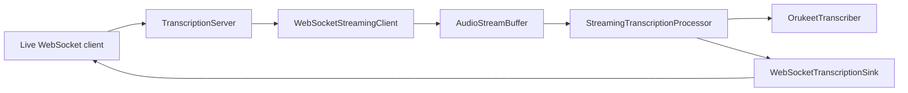
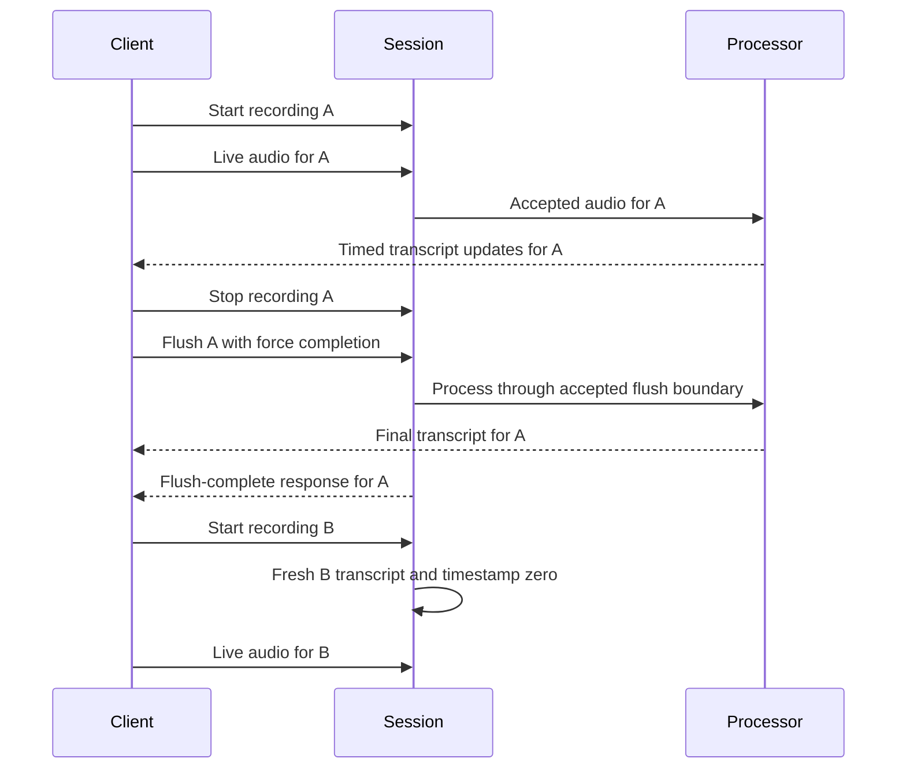

# Eavesdrop Architecture

Eavesdrop has one production audio path: live audio supplied by a transcriber over WebSocket. Transcript updates and control responses return on that connection. A connection can carry multiple recordings; a recording is not a socket lifetime.

## High-Level Architecture



### Core Components

- **TranscriptionServer (`server.py`)** initializes the recognition runtime and WebSocket server and manages live client connections.
- **WebSocketServer (`websocket.py`)** wraps `websockets` and hands connections to the server.
- **WebSocketStreamingClient** owns the live session, coordinates incoming audio and controls, and connects buffering, processing, and response delivery.
- **AudioStreamBuffer (`streaming/buffer.py`)** retains accepted audio and its recording-relative offsets for rolling recognition and revision.
- **StreamingTranscriptionProcessor (`streaming/processor.py`)** schedules recognition, updates provisional and completed segments, advances the processed boundary when permitted, and delivers results through a transcription sink.
- **OrukeetTranscriber (`transcription/orukeet.py`)** loads the fixed recognition model, serializes shared recognizer access, optionally runs standalone Silero VAD, and converts native timing to the recording timeline. Model dependencies load lazily so ordinary unit tests remain lightweight.
- **Configuration (`config.py`)** validates YAML settings through Pydantic, including recognition backend, live buffering, segmentation, and VAD configuration.

The live connection handles incoming audio and controls. The transcription-sink interface handles response delivery.

### Module Ownership

- `client/core.py` coordinates connection lifetime, capture, serialized recording transitions, and the single outstanding flush request. It pushes the original wire `TranscriptionMessage` directly to the caller. `client/connection.py` handles WebSocket messages and controls; stopping capture drains accepted frames before the next flush.
- `streaming/processor.py` coordinates scheduling, recognition, output delivery, and flush acknowledgement. Its `streaming/processing/` package separates buffer selection and wakeups (`scheduling.py`), model and native-worker lifetime (`recognition.py`), completion and transcript delivery (`output.py`), and identity-bearing recognition data (`models.py`).
- `transcription/session.py` owns recording transcript history and its tracing context. `transcription/tracing/context.py` owns shared timing, logging, recording-relative context, and observation creation. Callers use that state directly; `tracing/stages.py` manages stage timing and observation lifetime through `BaseTracer`.
- The active listener's `app/service.py` coordinates recording actions and finalization. `app/recording_keyboard.py` owns keyboard grabs and gestures; `recording/session.py` owns the recording transcript and captured audio. `app/workstation.py` owns media playback and the spectrum analyzer, `app/overlay.py` sends transcript updates over D-Bus, and `infra/langfuse.py` owns recording observations until transfer to finalization. `recording/finalizer.py` owns accepted snapshots through emission and history storage; `recording/rewrite.py` owns prompt loading, rewriting, and correction persistence. Later foreground changes preserve already accepted finalization work.
- `scripts/update-langfuse-models` retains the executable interface, `uv` dependency declaration, and repository-root `.env` lookup. `scripts/langfuse_models/` shares typed schemas and HTTP transport across catalog pricing translation and ownership-checked synchronization.

## Recognition Runtime and Timing Contract

The recognizer is Orukeet, using standard PyPI CPU sherpa-onnx with INT8 ONNX or pinned NeMo-Speech.cpp with Q8 GGUF on Vulkan. The optional `transcription` extra supplies sherpa-onnx, huggingface-hub, standalone Silero VAD, and PyTorch/torchaudio needed by Silero. Translation, alternate checkpoints, prompts, hotwords, and language selection are not part of the English-only server or client contract.

`transcription.model` is fixed to `oruk/orukeet`; `transcription.device` accepts `cpu` (default) or `vulkan`. CPU inference downloads the pinned released INT8 encoder/decoder/joiner archive through Hugging Face's standard cache, checks its SHA256, and safely extracts it for reuse. It uses a 16 kHz, 128-feature offline NeMo-transducer recognizer with greedy decoding and the CPU provider. Vulkan uses the pinned NeMo-Speech.cpp runtime and Q8 GGUF model on Linux x86_64, selecting GPU 0. Streaming remains rolling offline chunk re-decoding, not a stateful streaming recognizer. Model assets and inference-related caches persist for reuse independently of recording state.

Standalone Silero VAD remains ONNX CPU and supplies speech intervals as sample offsets into the unfiltered input chunk. Each speech segment is transcribed independently. CPU sherpa-onnx supplies native token onsets and durations at 80 ms granularity; `transcription/orukeet_timestamps.py` groups subword tokens into words while preserving punctuation and exact recognized text. Vulkan supplies native word timestamps, converted from milliseconds. For both backends, the adapter adds the speech segment's original offset and the recording chunk's offset once, preserving leading and internal silent gaps instead of compressing the recording timeline. No proportional word durations or separate forced alignment are invented.

Every transcription includes timed segments and individual word timestamps. Segment completion and buffer advancement use the same recording-relative boundaries. Starting a fresh recording establishes timestamp zero without changing model-cache lifetime.

Deploy directly on the host or use the unified CPU/Vulkan Docker image. The Debian bookworm CPU Torch/audio base, repository-root workspace lockfile, and `/opt/venv` retain CPU PyTorch/torchaudio for standalone Silero VAD. The final image includes `libvulkan1`, `libstdc++6`, and Mesa 25 `mesa-vulkan-drivers` from bookworm-backports. Container run tasks validate `SERVER_CONFIG` (default `packages/server/config.yaml`) as `EavesdropConfig`, mount that same file, and expose `/dev/dri` only for `transcription.device: vulkan`. Vulkan container deployment targets Linux x86_64 Mesa GPUs with the appropriate host kernel driver; it does not use NVIDIA container runtime, privileged mode, or `/dev/kfd`. The persistent task retains `--restart always`. There are no CUDA or ROCm inference variants. See the [server guide](./packages/server/README.md#docker-deployment) for setup and verification limits.

## Live Connection and Recording Lifecycle

The server and client exchange setup and readiness messages before streaming live audio. Operational health checks and error responses remain available. The shared wire package defines serialized messages; the Python client exposes the live recording controls. See the [client API guide](./packages/client/docs/api-client.md).

A recording has its own identifier, transcript state, and recording-relative timeline. Controls retain recording-identifier checks so a delayed control for an earlier recording cannot change a later one.

### Normal Recording Completion



Recording transitions preserve accepted work. Starting B while A's recognition or requested flush remains outstanding must not invalidate A's audio, transcript, recognition, or response. If B's audio is accepted early, it queues until A's final transcript and flush-complete response have been delivered. Only then can B begin processing with fresh recording-local state.

### Flush

Flush interrupts ordinary interval waiting and requests prompt processing through the audio already accepted at its boundary, including audio shorter than the normal processing minimum. It retains the force-completion option and the existing flush-complete acknowledgement.

- With `force_complete=True`, pending transcription through the accepted boundary completes and its final transcript is delivered before acknowledgement.
- With `force_complete=False`, the requested update and acknowledgement are delivered without forcing completion. VAD-enabled automatic completion remains independent of this choice.
- With no pending audio, including before the first frame or after consumption, the request still completes and acknowledges. It must not leave a pending request spinning or prevent other connections from progressing.

Audio arriving after a flush boundary is not permission to prematurely complete later content. In VAD-disabled operation, subsequent audio remains provisional until a later explicit force-completing request.

### Cancellation and Disconnect

Cancellation discards the active utterance, clears its utterance-local transcript history, and suppresses outstanding results from that cancelled work. It is not a force-completing flush or a recording transition that preserves accepted work. The client can stop and restart recording on the same connection after cancellation.

Disconnect releases connection-owned work. Cancellation and cleanup of owned asynchronous tasks are explicit and awaited; a closed connection must not leave session tasks or resources running or disrupt other live connections.

The client fails a pending flush immediately when its recording is cancelled or its connection closes. That request releases its recording-transition lock, allowing another recording after cancellation. A later request starts with a fresh completion future. Transcript callbacks receive accepted messages directly; no parallel transcript queue retains them.

## Transcription Pipeline and Completion

The processor repeatedly recognizes buffered live audio and revises one incomplete timed segment. Completed segments are stable. The segment window limits completed history while preserving the full incomplete segment and its revision source audio.

### VAD Enabled

Standalone VAD supplies speech and silence metadata. Preserve ordinary silence-based completion and the trailing incomplete-segment invariant for live updates, including a synthetic zero-length incomplete tail where required. `silence_completion_threshold` (default 0.8 seconds) controls silence completion; VAD's `min_silence_duration_ms` is derived from that threshold. Completed segment boundaries permit buffer advancement, and confirmed silence can be skipped without compressing timestamp offsets.

### VAD Disabled

All transcription since the last explicit completion forms one incomplete timed segment. Recognized portions retain their text, words, and original recording-relative word timestamps when combined. Elapsed time, silence, chunk duration, missing VAD metadata, and new audio cannot complete it. A non-force-completing flush acknowledges the update while leaving it incomplete. Only a flush with `force_complete=True` completes pending content through its accepted boundary. Cancellation discards its targeted utterance instead of completing it.

Buffer advancement and segment-window handling must preserve uncompleted work for revision and later explicit completion rather than treating a new segment as authority to discard it.

### Configuration Architecture

```yaml
transcription:
  silence_completion_threshold: 0.8
  vad_parameters:
    # min_silence_duration_ms is derived automatically as 800 ms
```

Users cannot manually set `min_silence_duration_ms` in VAD parameters. Validation rejects conflicting silence-duration settings, keeping VAD segmentation and silence-based completion aligned.

### Operational Tracing

Structured tracing remains available for pipeline visibility:

1. **Audio chunk processing:** buffer status and timestamp ranges.
2. **VAD analysis:** speech/silence timing when VAD ran; explicitly unanalyzed audio otherwise.
3. **Orukeet output:** native word boundaries, text, and recording-relative times.
4. **Completion decisions:** reasons for automatic or explicitly requested completion and provisional output.
5. **Buffer advancement:** how far the processed boundary moved and why.
6. **Client output:** segment lists with completed, incomplete, and synthetic flags.

`tracing_logger = get_logger("tracing")` provides structured logging. Operational logging is independent of audio retention.

## Verification Boundaries

Behavioral regression coverage drives setup, recording boundaries, audio frames, flush, cancellation, and disconnect through real local WebSocket connections. Deterministic recognition substitutes at the existing transcriber interface while the live orchestration, buffering, controls, and serialization remain real.

Protocol scenarios cover two recordings on one connection, held recognition during a transition, recording-relative timing, native word timing across silence, empty flush responsiveness, explicit-only completion with VAD disabled, enabled-VAD silence completion, cancellation suppression, and bounded disconnect cleanup. A responsive second connection is part of starvation and cleanup coverage.

These deterministic tests do not establish recognition quality or workstation integration. Real validation also requires the configured backend through WebSocket with the active-listener client, observing transcription, flush response, cancellation, a second recording, and cleanup. Standalone recognition smoke checks validate the backend but do not replace that end-to-end run.
